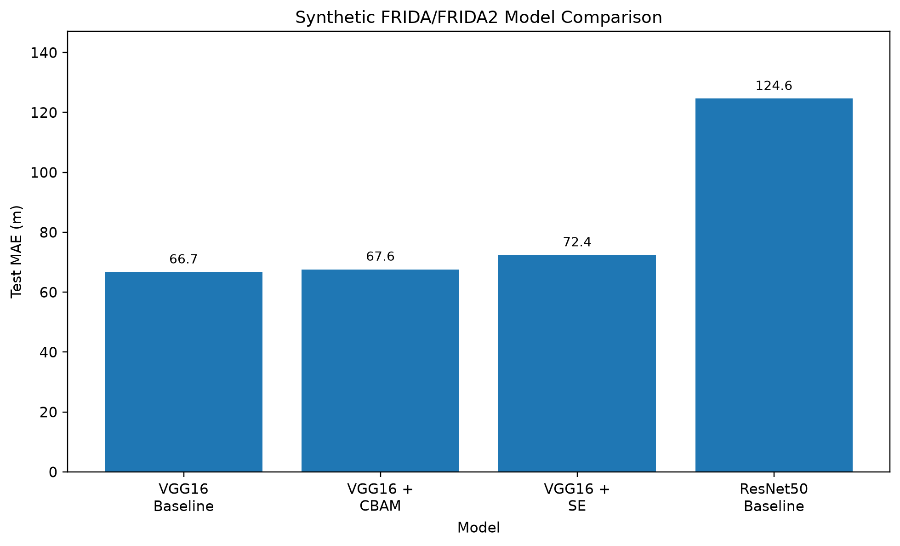
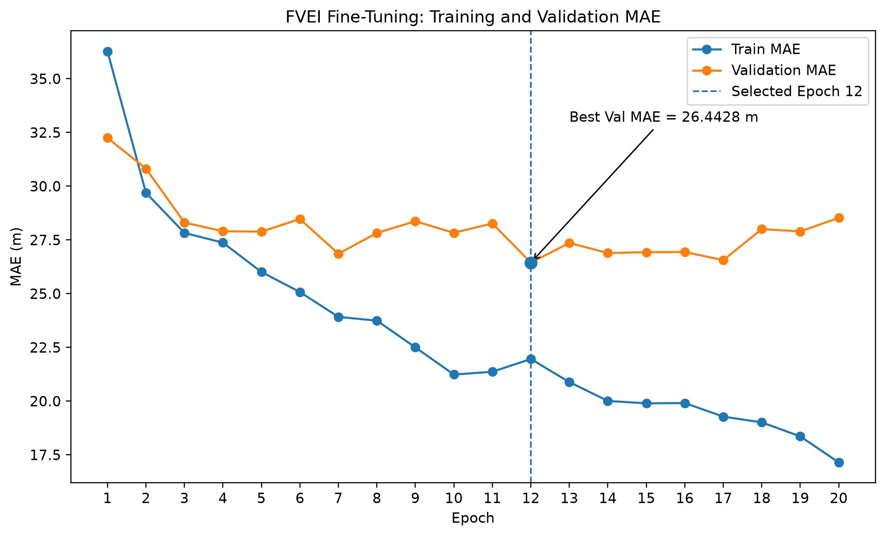
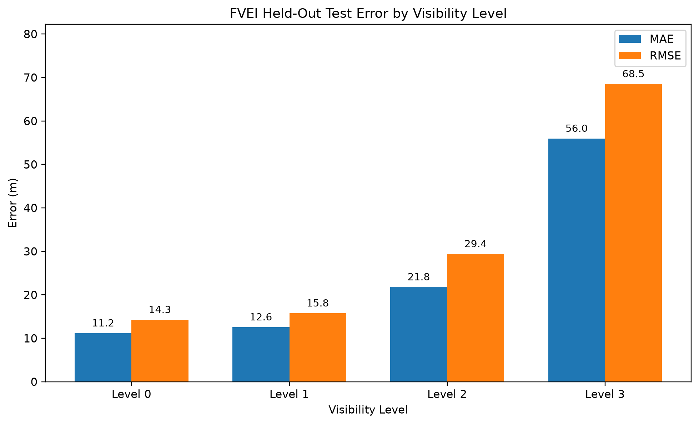

# Fog Visibility Estimation using Transfer Learning

TÜBİTAK 2209-A kapsamında yürütülen bu araştırma projesi, sisli hava koşullarında görüntü tabanlı **sürekli görüş mesafesi tahmini** için transfer öğrenme tabanlı CNN mimarilerini incelemektedir.

> **Project Status: Core research and software development completed.**

Çalışma kapsamında VGG16 ve ResNet50 mimarileri karşılaştırılmış, CBAM ve SE attention mekanizmaları değerlendirilmiş, seçilen VGG16 modeli gerçek dünya FVEI verisi üzerinde fine-tune edilmiş ve validation ile seçilen nihai model bağımsız held-out test setinde değerlendirilmiştir.

Final model Flask tabanlı web prototipine entegre edilmiştir.

---

# TÜBİTAK 2209-A Research Project

## Project Title

> **Transfer Öğrenme Temelli CNN Mimarilerinin Görüş Mesafesi Tahmininde Karşılaştırmalı Analizi**

## Project Status

**Teknik geliştirme tamamlandı.**

Tamamlanan ana aşamalar:

- FRIDA / FRIDA2 veri hazırlama
- VGG16 baseline
- ResNet50 baseline
- Baseline comparison
- CBAM attention
- SE attention
- CIDET auxiliary real-world experiments
- Benchmark-Visibility stress test
- FVEI dataset audit
- FVEI similarity screening
- FVEI reproducible split
- FVEI fine-tuning
- Validation-based checkpoint selection
- Locked held-out FVEI test
- Level-wise error analysis
- Flask API
- Web interface
- Checkpoint-independent automated API tests
- Real-checkpoint end-to-end inference test
- Final result tables
- Final result figures
- Research journal
- Weekly progress documentation
- Final results summary
- TÜBİTAK final report drafts
- Repository-wide quality control

Proje şu anda **final raporlama, danışman kontrolü ve yayın hazırlığı** aşamasındadır.

---

# Final Model

Final real-world inference model:

> **VGG16 FVEI Block5 Fine-Tuned**

Checkpoint:

```text
vgg16_fvei_block5_best.pth
```

Selected epoch:

**12**

## Final FVEI Results

| Metric | Result |
|---|---:|
| Validation MAE | **26.4428 m** |
| Held-Out Test MAE | **25.1347 m** |
| Held-Out Test RMSE | **38.4440 m** |
| Held-Out Test R² | **0.894442** |
| Held-Out Test Bias | **+3.4534 m** |
| Test Samples | **482** |

The held-out test split was not used during checkpoint selection or hyperparameter tuning.

No additional model tuning was performed after observing the final test results.

---

# Research Objectives

The main objectives of the project were:

1. Estimate continuous visibility distance from foggy images.
2. Adapt VGG16 and ResNet50 using transfer learning.
3. Compare the architectures using MAE.
4. Evaluate attention mechanisms on the selected baseline.
5. Examine synthetic-to-real domain shift.
6. Fine-tune the selected model using real-world data.
7. Evaluate the final model on an independent held-out test set.
8. Integrate the final model into a functional Flask prototype.

Primary model-selection metric:

> **Mean Absolute Error — MAE**

---

# Research Workflow

```text
FRIDA / FRIDA2
        ↓
Synthetic Dataset Preparation
        ↓
Scene-Based Split
        ↓
VGG16 Baseline
        ↓
ResNet50 Baseline
        ↓
Baseline Comparison
        ↓
Selected Synthetic Baseline: VGG16
        ↓
CBAM Attention
        ↓
SE Attention
        ↓
VGG16 Baseline Retained
        ↓
CIDET / Benchmark Auxiliary Experiments
        ↓
FVEI Dataset Audit
        ↓
FVEI Similarity Screening
        ↓
FVEI Train / Validation / Locked Test Split
        ↓
VGG16 Block5 + Regression Head Fine-Tuning
        ↓
Validation-Based Checkpoint Selection
        ↓
Locked FVEI Final Test
        ↓
Final FVEI Model
        ↓
Flask Inference Prototype
```

---

# 1. Synthetic Dataset — FRIDA / FRIDA2

The controlled architecture comparison was performed using synthetic fog images derived from FRIDA and FRIDA2.

| Property | Value |
|---|---:|
| FRIDA Base Scenes | 18 |
| FRIDA2 Base Scenes | 66 |
| Total Scenes | 84 |
| Visibility Levels | 8 |
| Total Images | 672 |

Visibility levels:

**50, 80, 100, 150, 200, 300, 500 and 800 metres**

A **scene-based split** was used to reduce the risk of different fog variants of the same scene appearing in different dataset partitions.

## Synthetic Split

| Split | Images |
|---|---:|
| Train | 464 |
| Validation | 96 |
| Test | 112 |

Random seed:

**42**

---

# 2. VGG16 vs ResNet50

ImageNet-pretrained VGG16 and ResNet50 architectures were adapted to continuous visibility regression.

## Baseline Results

| Model | Best Validation MAE | Test MAE |
|---|---:|---:|
| **VGG16** | **69.9705 m** | **66.7227 m** |
| ResNet50 | 121.8414 m | 124.6181 m |

Under the current FRIDA/FRIDA2 experimental configuration, VGG16 produced the lower held-out test MAE.

Selected synthetic baseline:

> **VGG16**

The initial research hypothesis expected ResNet50 to produce the lower error because of its residual architecture. The experimental results did **not** support this hypothesis under the current dataset and training configuration.

This result should not be interpreted as a general claim that VGG16 is superior to ResNet50.

---

# 3. Attention Experiments

Two attention approaches were evaluated on the selected VGG16 baseline:

- **CBAM — Convolutional Block Attention Module**
- **SE — Squeeze-and-Excitation**

## Synthetic Test Results

| Model | Validation MAE | Test MAE |
|---|---:|---:|
| **VGG16 Baseline** | 69.9705 m | **66.7227 m** |
| VGG16 + CBAM | **69.3274 m** | 67.6214 m |
| VGG16 + SE | 70.6083 m | 72.4412 m |
| ResNet50 Baseline | 121.8414 m | 124.6181 m |

CBAM slightly reduced validation MAE but did not improve the held-out synthetic test MAE.

SE also did not improve the baseline result.

Therefore, the original VGG16 baseline checkpoint was retained as the starting point for real-world adaptation.

---

# 4. Synthetic Model Comparison Figure



---

# 5. Auxiliary Real-World Experiments

Before the final FVEI workflow was available, CIDET and Benchmark-Visibility were used as auxiliary real-world experiments.

These experiments were retained because they provide useful evidence about synthetic-to-real domain shift and cross-dataset target-range sensitivity.

They were **not** used to select the final FVEI checkpoint.

## CIDET Zero-Shot Evaluation

Synthetic VGG16 zero-shot MAE:

> **2258.8934 m**

This result showed a substantial domain and target-range shift between the synthetic training setup and CIDET.

## CIDET Fine-Tuning

| Strategy | Validation MAE |
|---|---:|
| Head-only + L1 | 446.5714 m |
| Block5 + L1 | 326.6640 m |
| Block5 + Balanced Sampling + L1 | 334.9808 m |
| Block5 + Huber | **324.1948 m** |

---

# 6. Benchmark-Visibility Stress Test

The CIDET development model was additionally evaluated on Benchmark-Visibility without further adaptation.

| Metric | Result |
|---|---:|
| MAE | 11314.7801 m |
| RMSE | 13148.0802 m |
| Mean Signed Error | -11310.9893 m |
| Pearson Correlation | 0.585183 |
| Prediction Range | 97.43–1308.30 m |
| Target Range | 112–20000 m |

The experiment showed substantial prediction-range compression and systematic underestimation under a much broader target range.

This negative result was retained as a cross-dataset generalization finding and was not used for final FVEI model tuning.

---

# 7. FVEI Dataset Audit

After access to FVEI was obtained, a dedicated audit and preparation pipeline was developed for the original ZIP archive.

Source ZIP SHA256:

```text
07a04256b5e7df5319549e9546cf91da47817d978f52a36b6b53f6e43f36154d
```

## Audit Summary

| Category | Samples |
|---|---:|
| Retained | 4109 |
| Exact-label | 3209 |
| Level-4 / 500 m analysis group | 900 |
| Conflicting duplicates rejected | 229 |
| Outside-level-range rejected | 32 |
| Redundant identical images removed | 130 |

## Exact-Label Distribution

| Level | Samples | Observed Range |
|---|---:|---:|
| Level 0 | 785 | 12–49 m |
| Level 1 | 846 | 51–99 m |
| Level 2 | 793 | 101–199 m |
| Level 3 | 785 | 201–499 m |

The 900 images carrying the 500 m label were kept separate from exact-label regression metrics.

> **Methodological note:** the precise ceiling/censored semantics of the 500 m group should be independently verified from the official dataset documentation before publication.

---

# 8. FVEI Split Strategy

Exact-label samples were split using visibility-level stratification.

Initial target proportions:

```text
Train       70%
Validation  15%
Test        15%
```

Random seed:

**42**

Strict pre-training cross-split similarity screening identified two suspicious validation-side samples:

```text
fog open data/0/0-381-47.jpg
fog open data/1/1-00073-62.jpg
```

These two validation samples were excluded.

The test split was not changed.

## Final FVEI Split

| Split | Samples |
|---|---:|
| Train | 2245 |
| Validation | 480 |
| Locked Test | 482 |
| Similarity Exclusions | 2 |
| Level-4 / 500 m Analysis | 900 |

## Exact-Label Level Distribution

| Split | Level 0 | Level 1 | Level 2 | Level 3 |
|---|---:|---:|---:|---:|
| Train | 549 | 592 | 555 | 549 |
| Validation | 117 | 126 | 119 | 118 |
| Test | 118 | 127 | 119 | 118 |

Reliable scene/camera identifiers were not available in the current FVEI pipeline.

Therefore, residual sample dependence cannot be completely excluded even after similarity screening.

---

# 9. FVEI Fine-Tuning

Starting checkpoint:

```text
vgg16_baseline_best.pth
```

Fine-tuning strategy:

```text
VGG16 Blocks 1–4 → Frozen
VGG16 Block 5     → Trainable
Regression Head   → Trainable
```

## Training Configuration

| Parameter | Value |
|---|---:|
| Epochs | 20 |
| Batch Size | 16 |
| Block 5 Learning Rate | 1e-5 |
| Regression Head Learning Rate | 1e-4 |
| Weight Decay | 1e-5 |
| Loss | L1Loss / MAE |
| Random Seed | 42 |

Trainable parameters:

| Parameter Group | Count |
|---|---:|
| Block 5 | 7,079,424 |
| Regression Head | 12,911,361 |

Only the train and validation splits were used during development.

The locked test split remained unavailable to the training pipeline.

---

# 10. FVEI Model Selection

The checkpoint was selected using validation MAE.

| Metric | Result |
|---|---:|
| Best Epoch | **12** |
| Best Validation MAE | **26.4428 m** |

Final checkpoint:

```text
vgg16_fvei_block5_best.pth
```

Training MAE continued to decrease after epoch 12, while validation MAE did not show a sustained improvement.

This behaviour is consistent with mild overfitting after the validation-selected checkpoint.

## Fine-Tuning Curve



---

# 11. Locked FVEI Test Evaluation

After checkpoint selection was completed, the validation-selected epoch 12 checkpoint was evaluated on the previously unused 482-image exact-label test split.

## Final Test Results

| Metric | Result |
|---|---:|
| Test Samples | 482 |
| **MAE** | **25.1347 m** |
| **RMSE** | **38.4440 m** |
| **R²** | **0.894442** |
| Bias / Mean Signed Error | **+3.4534 m** |

Validation MAE:

> **26.4428 m**

Held-out Test MAE:

> **25.1347 m**

No checkpoint selection, hyperparameter tuning or training-strategy modification was performed after observing the locked test results.

---

# 12. Level-Wise FVEI Test Results

| Level | N | MAE | RMSE | Bias |
|---|---:|---:|---:|---:|
| Level 0 | 118 | 11.1879 m | 14.2664 m | +7.5328 m |
| Level 1 | 127 | 12.5699 m | 15.7690 m | -3.7466 m |
| Level 2 | 119 | 21.8013 m | 29.4082 m | +8.4794 m |
| Level 3 | 118 | 55.9664 m | 68.5106 m | +2.0548 m |

Level 3 produced the highest MAE and RMSE in the current held-out FVEI test.

The relatively small Level 3 bias compared with MAE and RMSE suggests that the larger error is not explained only by a one-direction systematic offset.

## Level-Wise Error Figure



---

# 13. Level-4 / 500 m Separate Analysis

The 900 samples in this group were evaluated separately from exact-label MAE, RMSE and R².

| Metric | Result |
|---|---:|
| Samples | 900 |
| Mean Prediction | 563.4542 m |
| Median Prediction | 559.8888 m |
| Predictions ≥ 500 m | 840 / 900 |
| Fraction ≥ 500 m | 93.33% |
| Mean Shortfall Below 500 m | 1.6444 m |

These values are reported separately and are not interpreted as standard exact-label regression metrics.

---

# 14. Flask Web Prototype

The final FVEI checkpoint is integrated into a Flask-based research prototype.

## Final Inference Model

```text
VGG16 FVEI Block5 Fine-Tuned
```

## API Endpoints

```text
GET  /
GET  /health
POST /predict
```

The web application supports:

- JPG / JPEG / PNG upload
- Image preview
- Model inference
- Visibility prediction in metres
- REST-style prediction endpoint
- Health endpoint

Example `/predict` response:

```json
{
  "visibility_m": 245.31,
  "unit": "m",
  "model": "VGG16 FVEI Block5 Fine-Tuned",
  "checkpoint_epoch": 12
}
```

Automated API tests:

> **6 / 6 passed**

The automated API test suite is checkpoint-independent.

A separate local smoke test using the real final checkpoint also verified the full:

```text
upload
  ↓
image decoding
  ↓
preprocessing
  ↓
VGG16 FVEI inference
  ↓
JSON response
```

workflow successfully.

---

# 15. Running the Flask Prototype

Create and activate a Python environment, then install the project dependencies:

```bash
pip install -r requirements.txt
```

The trained checkpoint is intentionally not tracked by Git.

Place the final checkpoint at:

```text
results/checkpoints/vgg16_fvei_block5_best.pth
```

Run the application from the repository root:

```bash
python -m src.api.app
```

Default local address:

```text
http://127.0.0.1:5000
```

Health endpoint:

```text
http://127.0.0.1:5000/health
```

---

# 16. Preprocessing

Common inference pipeline:

```text
RGB Conversion
      ↓
Resize 224 × 224
      ↓
ToTensor
      ↓
ImageNet Normalization
      ↓
VGG16
      ↓
Visibility Regression
```

ImageNet normalization:

```text
Mean = [0.485, 0.456, 0.406]
Std  = [0.229, 0.224, 0.225]
```

---

# 17. Reproducibility

The primary experimental configuration uses:

> **Random Seed: 42**

Reproducibility measures include:

- fixed dataset splits
- common preprocessing
- validation-based checkpoint selection
- separate training and evaluation scripts
- explicit experiment reports
- deterministic settings where supported

During GPU training, strict deterministic execution was not available for every CUDA operation used by VGG16.

The training utilities therefore use:

```python
torch.use_deterministic_algorithms(
    True,
    warn_only=True,
)
```

Bit-for-bit identical GPU reproduction is therefore not guaranteed.

---

# 18. Technology Stack

- Python
- PyTorch
- Torchvision
- Flask
- Pillow
- NumPy
- Pandas
- SciPy
- Scikit-learn
- Matplotlib
- HTML
- CSS
- JavaScript
- Pytest

---

# 19. Repository Structure

```text
.
├── data/
│   ├── generated/
│   ├── interim/
│   ├── processed/
│   ├── raw/
│   └── splits/
├── docs/
│   ├── literature/
│   ├── research_notes/
│   └── reports/
├── figures/
├── notebooks/
├── results/
├── src/
│   ├── api/
│   │   ├── static/
│   │   ├── templates/
│   │   ├── app.py
│   │   └── inference.py
│   ├── data/
│   ├── evaluation/
│   ├── models/
│   └── training/
├── scripts/
│   └── sanitize_result_paths.py
├── tests/
├── .github/workflows/tests.yml
├── pytest.ini
├── README.md
└── requirements.txt
```

Datasets and model checkpoints are intentionally excluded from Git tracking. The FVEI split manifest and six image-level FVEI prediction CSVs are also kept local until redistribution permission is confirmed. Aggregate FVEI metrics, statistical summaries, training histories and plots are published, together with the synthetic experiment results. See [`docs/DATASETS.md`](docs/DATASETS.md) for data access and the exact reproduction limits.

A public checkout can recompute synthetic and multi-seed statistics with `python -m src.evaluation.statistical_analysis --no-figure --output-dir results/ci_statistics`. Missing FVEI prediction files are skipped; this command writes to a separate directory and preserves the published full report. Recomputing FVEI bootstrap intervals requires the original private prediction CSVs. Reproducing the same FVEI split also requires the existing private locked manifest; it must not be regenerated.

---

# 20. Important Research Documents

## Final Project Documents

- [`final_results_summary.md`](docs/reports/final_results_summary.md)
- [`tubitak_final_report_draft.md`](docs/reports/tubitak_final_report_draft.md)
- [`tubitak_final_report_official_format.md`](docs/reports/tubitak_final_report_official_format.md)
- [`weekly_progress_log.md`](docs/reports/weekly_progress_log.md)

## Experiment Reports

- [`baseline_comparison.md`](docs/reports/baseline_comparison.md)
- [`attention_comparison.md`](docs/reports/attention_comparison.md)
- [`se_attention_comparison.md`](docs/reports/se_attention_comparison.md)
- [`fvei_real_world_evaluation.md`](docs/reports/fvei_real_world_evaluation.md)
- [`cidet_real_world_evaluation.md`](docs/reports/cidet_real_world_evaluation.md)
- [`benchmark_visibility_external_evaluation.md`](docs/reports/benchmark_visibility_external_evaluation.md)

## Statistics, Data and Reproducibility

- [`statistical_analysis.md`](docs/reports/statistical_analysis.md)
- [`DATASETS.md`](docs/DATASETS.md)
- [`REPRODUCIBILITY.md`](docs/REPRODUCIBILITY.md)

## Research Journal

[`docs/research_notes/arastirma_gunlugu.md`](docs/research_notes/arastirma_gunlugu.md)

The final results summary and TÜBİTAK report drafts retain their original content. The later validation experiments and statistical findings are documented separately in [`docs/reports/statistical_analysis.md`](docs/reports/statistical_analysis.md) and the sections below; those drafts still need corresponding editorial updates before submission.

---

# Statistical Analysis and Validation Experiments

The research proposal formulated the hypothesis in terms of a *statistically significant* MAE difference. This is now tested directly from the saved predictions with [`src/evaluation/statistical_analysis.py`](src/evaluation/statistical_analysis.py) (no retraining). Full report: [`docs/reports/statistical_analysis.md`](docs/reports/statistical_analysis.md).

The 8 fog variants of a scene are not independent, so the **scene** is the unit of analysis on the synthetic test set (112 images, 14 scenes): scene-level Wilcoxon signed-rank test, scene-level cluster bootstrap 95% CI, Holm correction.

| Comparison vs VGG16 Baseline | MAE difference [95% CI] | Scenes where VGG16 is better | Holm-adjusted p |
|---|---:|---:|---:|
| ResNet50 Baseline | +57.90 m [48.84, 67.29] | 14 / 14 | 3.7 × 10⁻⁴ |
| VGG16 + CBAM | +0.90 m [−3.24, 5.39] | 8 / 14 | 0.76 |
| VGG16 + SE | +5.72 m [3.29, 7.95] | 13 / 14 | 0.0024 |

- The difference between VGG16 and ResNet50 is statistically significant **in the opposite direction** to the hypothesis.
- CBAM is statistically indistinguishable from the baseline.
- SE is significantly worse than the baseline.
- FVEI locked test MAE: **25.13 m [23.12, 27.20]** (image-level, level-stratified bootstrap; scene/camera IDs are unavailable, so this interval may be slightly optimistic).

The table above describes the original seed-42 experiments. The extended experiments use the frozen [`model selection protocol`](docs/MODEL_SELECTION_PROTOCOL.md); commands and registration chronology are in [`docs/REPRODUCIBILITY.md`](docs/REPRODUCIBILITY.md).

| Validation comparison | Test MAE (m) | Difference vs reference [95% CI] | Holm p / outcome |
|---|---|---|---|
| **Primary: VGG16 vs ResNet50, maximum 200 epochs, patience 20, 5 seeds** | VGG16 **53.87 ± 0.81**; ResNet50 **81.41 ± 1.94** | ResNet50 − VGG16: **+27.53 [7.94, 48.91] m** | **0.0419**; VGG16 better in 5/5 seeds; convergence warning below |
| Sensitivity: both architectures, 20 epochs, 5 seeds | VGG16 63.99 ± 1.31; ResNet50 127.64 ± 3.71 | +63.65 [54.43, 72.84] m | 0.000366; ResNet50 did not converge in any seed |
| Sensitivity: VGG16 20 vs ResNet50 50 epochs, 5 seeds | VGG16 63.99 ± 1.31; ResNet50 86.29 ± 2.00 | +22.30 [11.75, 32.42] m | 0.00464; ResNet50 did not converge in any seed |
| Conditional ResNet50 + CBAM / SE | Full experiments not run | Trigger condition was not met | Existing VGG16 attention results remain applicable |
| FVEI: ResNet50 synthetic → real vs final VGG16, seed 42 | ResNet50 27.48; VGG16 25.13 | +2.34 [0.62, 4.09] m | 0.0636; no significant difference after Holm correction |
| FVEI ablation: VGG16 ImageNet → real vs staged final VGG16, seed 42 | ImageNet → real 24.33; staged 25.13 | −0.80 [−1.96, 0.38] m | 0.0700; a benefit from the synthetic stage was not established |

The exact primary protocol decision is **“VGG16 anlamlı düzeyde daha iyi (uyarı: tüm seed'ler bütçe içinde yakınsamadı)”**. VGG16 early-stopped in 5/5 seeds (58–96 epochs), ResNet50 in 3/5 (132–179 epochs); ResNet50 seeds 7 and 123 reached the 200-epoch cap. The budget was not increased. The statistical conditions favor VGG16 within this registered budget, but this is not a comparison in which every ResNet50 seed demonstrably converged. The ResNet50 superiority hypothesis is rejected in the opposite direction within this experiment, with that limitation.

Synthetic values are means ± sample standard deviations over five training seeds on one fixed scene split. Confidence intervals and tests use 14 scenes after averaging errors over paired seeds; they do not establish performance across new scene splits. Earlier fixed-budget results were already known before registration, so the new runs are not an independent test-set replication. CBAM/SE full training was skipped because the required exact ResNet50-winning decision was not obtained. The secondary complexity comparison was not triggered because the primary decision was neither partial evidence nor no significant difference.

---

# 21. Main Research Findings

1. VGG16 produced a lower held-out synthetic test MAE than ResNet50 under the current FRIDA/FRIDA2 experimental configuration.

2. The initial hypothesis expecting ResNet50 to outperform VGG16 was not supported.

3. VGG16 synthetic Test MAE was **66.7227 m**.

4. CBAM slightly improved validation MAE but did not improve held-out test MAE.

5. SE did not improve the VGG16 baseline.

6. CIDET experiments demonstrated substantial synthetic-to-real domain shift.

7. Benchmark-Visibility demonstrated major target-range sensitivity and prediction-range compression.

8. FVEI fine-tuning selected epoch 12 using validation MAE.

9. FVEI Validation MAE was **26.4428 m**.

10. Locked FVEI Test MAE was **25.1347 m**.

11. Locked FVEI Test RMSE was **38.4440 m**.

12. Locked FVEI Test R² was **0.894442**.

13. Level 3 was the most difficult exact-label FVEI group.

14. The final Flask prototype uses the validation-selected FVEI checkpoint.

15. The project target of **MAE < 100 m** was achieved in both the selected synthetic baseline and final FVEI evaluation.

16. Under the registered 200-epoch / patience-20 protocol, VGG16 achieved **53.87 ± 0.81 m**, versus **81.41 ± 1.94 m** for ResNet50, and was better in all five paired seeds. The scene-level difference was **27.53 m [7.94, 48.91]**, Holm p = **0.0419**. The ResNet50 superiority hypothesis was rejected in the opposite direction within this budget, with a convergence warning: two ResNet50 seeds reached the cap.

17. The architecture gap depends on the training budget. All ResNet50 seeds selected the last epoch under both old fixed budgets (20 and 50); the registered early-stopping experiment converged in 3/5 ResNet50 seeds and 5/5 VGG16 seeds. The primary comparison uses both early-stopping groups; fixed-budget comparisons are sensitivity analyses.

18. ResNet50 + CBAM/SE full experiments were not run because the registered trigger condition was not met. The existing VGG16 attention comparisons remain the available attention evidence.

19. On FVEI, ResNet50 had a modestly higher MAE than final VGG16 (+2.34 m); the difference was not significant after Holm correction (p = 0.0636). These single-seed results are secondary evidence.

20. The ImageNet → FVEI ablation did not establish a measurable benefit from the synthetic training stage: its difference from staged VGG16 was −0.80 m [−1.96, 0.38], Holm p = 0.0700. This does not establish equivalence.

21. The final deployment model remains `vgg16_fvei_block5_best.pth`; it was not changed in response to any locked-test result.

---

# 22. Completed Work

- [x] Literature review
- [x] FRIDA / FRIDA2 analysis
- [x] Synthetic dataset preparation
- [x] Scene-based splitting
- [x] VGG16 baseline
- [x] ResNet50 baseline
- [x] Baseline comparison
- [x] Synthetic model selection
- [x] CBAM implementation and evaluation
- [x] SE implementation and evaluation
- [x] Attention comparison
- [x] CIDET auxiliary experiments
- [x] Benchmark-Visibility stress test
- [x] FVEI dataset audit
- [x] Duplicate and similarity screening
- [x] Reproducible FVEI split
- [x] FVEI DataLoader
- [x] FVEI fine-tuning pipeline
- [x] GPU fine-tuning
- [x] Validation-based model selection
- [x] Locked FVEI final test
- [x] Level-wise error analysis
- [x] Level-4 / 500 m separate analysis
- [x] Final FVEI inference wrapper
- [x] Flask API
- [x] Web interface
- [x] Checkpoint-independent Flask tests
- [x] Real-checkpoint inference smoke test
- [x] Final result tables
- [x] Final result figures
- [x] Final results summary
- [x] Research journal update
- [x] Weekly progress log
- [x] Repository quality control
- [x] TÜBİTAK final report content draft
- [x] TÜBİTAK official-format report draft

> **Core research and software development are complete.**

---

# 23. Remaining Work

The remaining tasks are related to **submission and publication preparation**, not core software development.

- [ ] Complete the TÜBİTAK expenditure section using official BİDEB records
- [ ] Complete final date and signature fields
- [ ] Apply advisor revisions
- [ ] Prepare final DOCX / PDF submission files
- [ ] Prepare publication-oriented manuscript

Validation experiments completed on 2026-10-18 (see `docs/REPRODUCIBILITY.md`):

- [x] Local runtime verification: 41 tests passed; synthetic VGG16 and ResNet50 + CBAM early-stopping dry runs passed on CUDA; the FVEI ResNet50 dry run also passed (2026-10-18)
- [x] Model selection and conditional attention protocols registered in commits `a15671d` and `1594009`, both pushed before the definitive convergence runs
- [x] CI workflow installed at `.github/workflows/tests.yml`
- [x] Statistical significance analysis of the synthetic comparisons
- [x] Multi-seed synthetic training (VGG16, ResNet50, ResNet50 50 epochs)
- [x] Registered early-stopping experiments: 5 seeds per architecture, maximum 200 epochs, patience 20; VGG16 5/5 and ResNet50 3/5 early-stopped before the cap
- [x] Conditional ResNet50 attention step checked: full training skipped because the trigger condition was not met
- [x] ResNet50 fine-tuning and locked evaluation on FVEI
- [x] VGG16 ImageNet → FVEI ablation (contribution of the synthetic stage)

| Validation experiment | Test MAE (m) |
|---|---:|
| Synthetic VGG16, 20 epochs, 5 seeds | 63.99 ± 1.31 |
| Synthetic ResNet50, 20 epochs, 5 seeds | 127.64 ± 3.71 |
| Synthetic ResNet50, 50 epochs, 5 seeds | 86.29 ± 2.00 |
| **Primary synthetic VGG16, max 200 epochs / patience 20, 5 seeds** | **53.87 ± 0.81** |
| **Primary synthetic ResNet50, max 200 epochs / patience 20, 5 seeds** | **81.41 ± 1.94** |
| ResNet50 synthetic → FVEI, seed 42 | 27.48 |
| VGG16 ImageNet → FVEI, seed 42 | 24.33 |

The synthetic values are means ± sample standard deviations across training seeds with the scene split fixed. VGG16 had lower test MAE in all five paired seeds in each comparison. ResNet50 improved substantially with longer training. The primary early-stopping comparison still favored VGG16 (difference +27.53 m, 95% CI 7.94–48.91; Holm p = 0.0419), with a warning because two ResNet50 seeds reached the 200-epoch cap. No budget extension was made.

On FVEI, the original VGG16 reference has MAE 25.13 m. Relative to that reference, the ResNet50 MAE difference was +2.34 m (95% bootstrap CI 0.62–4.09; Holm-adjusted Wilcoxon p = 0.0636), and the ImageNet-only VGG16 difference was −0.80 m (95% CI −1.96–0.38; adjusted p = 0.0700). Neither comparison reached significance under the adjusted Wilcoxon tests. This ablation did not establish a benefit from the synthetic stage. These FVEI experiments use one training seed; their image-level intervals cannot account for unknown scene/camera dependence. The original deployment checkpoint is retained under the locked-test protocol. Full results: [`statistical_analysis.md`](docs/reports/statistical_analysis.md).

Optional future work:

- [ ] Perform an additional external real-world evaluation if FHVI access becomes available

The current locked FVEI test set should not be reused for future model tuning while still being described as an independent final test set.

---

# 24. Methodological Notes

Results should be interpreted with the following limitations in mind:

- Synthetic and real-world MAE values belong to different data distributions and should not be treated as directly equivalent performance measurements.
- The FVEI locked test split was not used during model selection.
- No additional tuning was performed after observing the locked test result.
- The FVEI split is stratified by visibility level.
- Reliable FVEI scene/camera identity information was not available in the current pipeline.
- Similarity screening reduces but cannot completely eliminate residual sample dependence.
- Two suspicious validation samples were excluded; the test split was not modified.
- The main experiments use one primary split and random seed 42.
- Statistical tests (Section "Statistical Analysis and Validation Experiments") use one split and seed 42; seed variability is assessed separately with the multi-seed experiments.
- Some CUDA operations are not strictly deterministic.
- Level-4 / 500 m label semantics require independent source verification before publication.
- CIDET and Benchmark results did not influence final FVEI checkpoint selection.

---

# 25. Disclaimer

This repository contains an academic research project developed within the scope of the **TÜBİTAK 2209-A University Students Research Projects Support Program**.

Model performance depends on dataset distribution, camera characteristics, environmental conditions and visibility range.

The Flask application is a research prototype and does not replace a certified meteorological visibility sensor.

Reported MAE, RMSE and R² values represent aggregate dataset-level performance and should not be interpreted as a guaranteed error bound for an individual uploaded image.

---

# License and Dataset Usage

Software and documentation originally developed for this repository are distributed under the **MIT License**.

Third-party datasets, pretrained model components and external resources remain subject to their own licenses, terms of use and citation requirements.

Dataset files and trained checkpoints are not redistributed through this repository.
